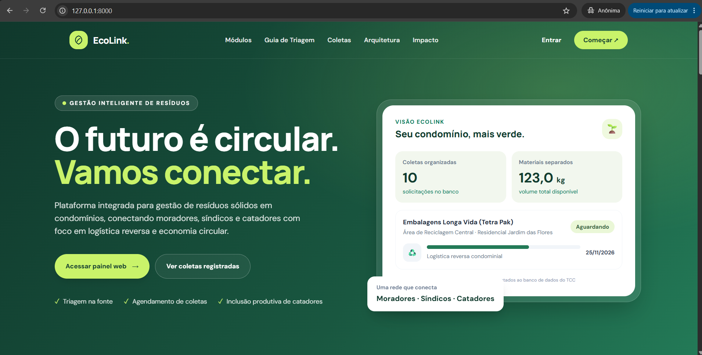
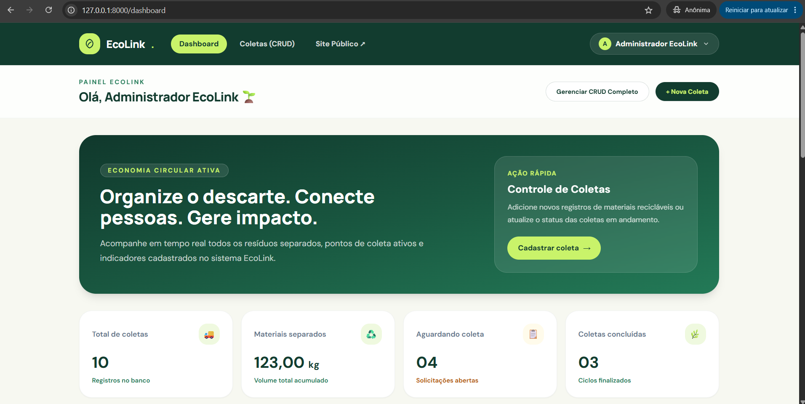
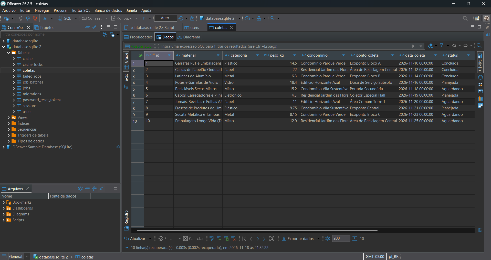
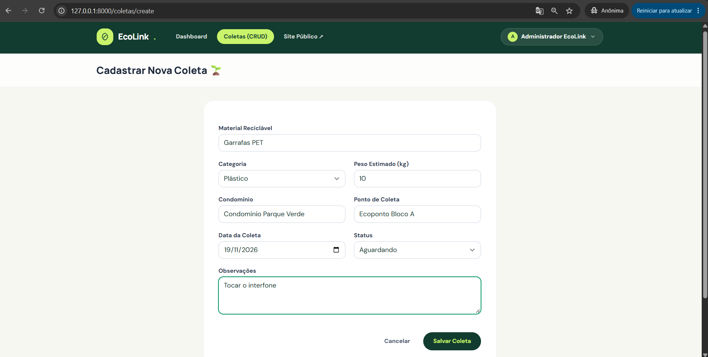
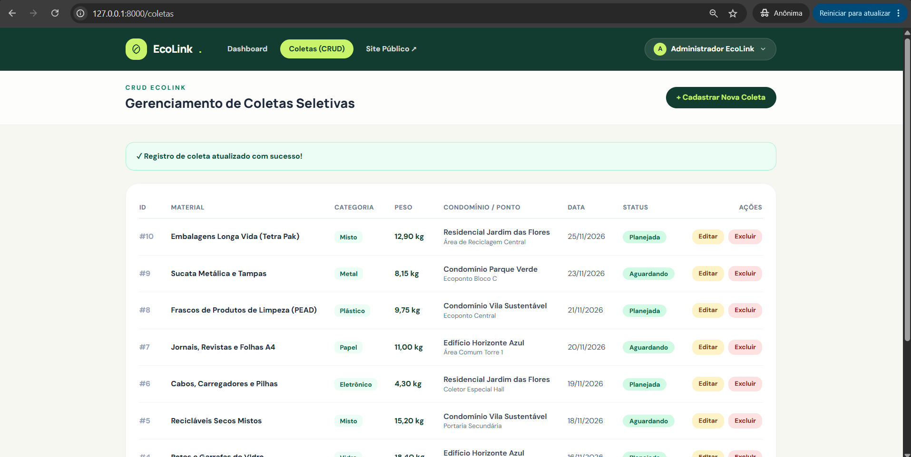

# EcoLink — Gestão Inteligente de Resíduos em Condomínios

Plataforma web desenvolvida em **Laravel 13** e **Laravel Breeze** para a gestão inteligente de resíduos sólidos em ambientes condominiais[cite: 5, 9]. O projeto integra **moradores**, **síndicos** e **catadores (profissionais da reciclagem)** em um único ecossistema, promovendo a triagem correta na fonte, o agendamento de coletas e a inclusão produtiva na economia circular[cite: 3, 6].

---

## Objetivo do TCC

Inspirado nas diretrizes da **Política Nacional de Resíduos Sólidos (Lei nº 12.305/10)**, o EcoLink busca solucionar a falta de padronização e de comunicação no descarte cotidiano em condomínios residenciais por meio de[cite: 3, 4]:

- **Educação Ambiental (Módulo do Morador):** orientações sobre *como descartar*, *por que reciclar* e *triagem de produtos* (plásticos, papéis, metais, vidros e eletrônicos)[cite: 6].
- **Gestão Administrativa (Módulo do Síndico):** cadastro, acompanhamento e controle completo (CRUD) das solicitações de coleta seletiva, volumes em kg e pontos de descarte[cite: 6].
- **Previsibilidade Logística (Módulo do Catador):** visualização das coletas disponíveis e seus status (`Aguardando`, `Planejada` e `Concluída`), otimizando rotas e reduzindo deslocamentos improdutivos[cite: 3, 6].

---

## Requisitos Implementados na Plataforma Web

- **Autenticação completa com Laravel Breeze:** rotas e telas de login, cadastro de usuários, recuperação de senha e painel administrativo (`Dashboard`), estilizadas com a identidade visual do EcoLink[cite: 5].
- **CRUD Completo de Coletas (`ColetaController`):** criação, listagem, edição e exclusão de registros de materiais recicláveis.
- **Exibição Dinâmica na Home e no Dashboard:** tanto a página inicial pública (`/`) quanto o painel logado (`/dashboard`) consultam o banco de dados em tempo real e exibem os indicadores totais e todos os registros cadastrados.
- **Middleware Personalizado (`VerificaAcessoEcoLink`):** registrado com o alias `ecolink.acesso` em `bootstrap/app.php`, protege o acesso ao Dashboard e às rotas do CRUD, bloqueando alterações por perfis visitantes e registrando o cabeçalho `X-EcoLink-Middleware`.
- **Rota Fallback (`Route::fallback`):** captura qualquer URL inexistente no sistema e exibe uma página `404` personalizada (`resources/views/errors/fallback.blade.php`) com retorno seguro para a plataforma.
- **Migrations e Seeders (`ColetaSeeder`):** estruturação da tabela `coletas` e população automática do banco com **10 registros reais** de materiais recicláveis, além de usuários de acesso.

---

## Arquitetura e Tecnologias

### Stack desta Aplicação Web
- **Back-end:** PHP 8.4+ e Laravel 13 (padrão MVC).
- **Autenticação e Segurança:** Laravel Breeze + Middleware `VerificaAcessoEcoLink`.
- **Front-end:** Blade Templates, Tailwind CSS e Alpine.js.
- **Empacotamento de Assets:** Vite.
- **Banco de Dados:** SQLite (padrão local) / compatível com MySQL.

### Arquitetura Híbrida do Ecossistema EcoLink (TCC)

| Camada | Tecnologias | Papel no Sistema |
| :--- | :--- | :--- |
| **Web (Gestão)** | Laravel, Laravel Breeze, Tailwind CSS | Painel administrativo seguro para síndicos gerenciarem solicitações de coleta[cite: 6]. |
| **Mobile** | React Native, TypeScript | Aplicativo para moradores e catadores acessarem guias de triagem e rotas de coleta[cite: 6]. |
| **Backend (API)** | Node.js, TypeScript | API responsável pelo processamento assíncrono e integração entre as interfaces[cite: 5, 6]. |
| **Banco de Dados** | MySQL / SQLite | Armazenamento estruturado de usuários, solicitações de coleta e histórico[cite: 6]. |

---

## Pré-requisitos

- **PHP 8.4 ou superior** (com extensões `pdo_sqlite`, `pdo_mysql`, `mbstring`, `openssl`, `curl`, `fileinfo` e `zip` habiladas).
- **Composer** (gerenciador de dependências PHP).
- **Node.js (v20.19+ ou v22+)** e **npm**.
- **Git**.

---

## Instalação e Execução Local

Execute os comandos abaixo no terminal (PowerShell) dentro da pasta onde deseja clonar o projeto:

### 1. Clonar o repositório
```powershell
git clone [https://github.com/RodrigoRocha88/EcoLink-atvd-PW.git](https://github.com/RodrigoRocha88/EcoLink-atvd-PW.git)
cd EcoLink-atvd-PW
```

### 2. Instalar dependências do PHP e do Front-end
```powershell
composer install
npm install
```

### 3. Configurar o arquivo `.env` e a chave da aplicação
```powershell
copy .env.example .env
php artisan key:generate
```

### 4. Executar as Migrations e o Seeder (10 registros)
```powershell
php artisan migrate:fresh --seed
```
*(Se o Laravel perguntar se deseja criar o arquivo `database/database.sqlite`, confirme com `yes` ou aperte **Enter**).*

> **Credenciais de acesso criadas pelo Seeder:**
> - **E-mail:** `admin@ecolink.com`
> - **Senha:** `12345678`

### 5. Compilar o Front-end e iniciar o servidor
```powershell
npm run build
php artisan serve
```

Acesse no navegador:
- **Página Inicial (Home):** http://127.0.0.1:8000
- **Login:** http://127.0.0.1:8000/login
- **Cadastro:** http://127.0.0.1:8000/register
- **Recuperação de Senha:** http://127.0.0.1:8000/forgot-password
- **Dashboard:** http://127.0.0.1:8000/dashboard
- **Gerenciamento CRUD de Coletas:** http://127.0.0.1:8000/coletas
- **Teste da Rota Fallback (404):** http://127.0.0.1:8000/pagina-inexistente

---

## Demonstração do Projeto (Prints)

### 1. Site funcionando em `localhost` (Home com dados do TCC)


### 2. Autenticação Laravel Breeze e Dashboard


### 3. Banco de Dados (`Migrations` e `Seeders` com 10 registros)


### 4. Front-end CRUD — Cadastro e Listagem


### 5. Front-end CRUD — Edição e Exclusão


### 6. Back-end CRUD e Middleware


### 7. Rota Fallback (`Route::fallback` — Página 404 personalizada)


---

## Organização do Projeto

```text
EcoLink-atvd-PW/
├── app/
│   ├── Http/
│   │   ├── Controllers/
│   │   │   └── ColetaController.php          # Operações CRUD (index, create, store, edit, update, destroy)
│   │   └── Middleware/
│   │       └── VerificaAcessoEcoLink.php     # Middleware personalizado de controle de acesso
│   └── Models/
│       ├── Coleta.php                        # Model Eloquent das coletas seletivas
│       └── User.php                          # Model de usuários (Laravel Breeze)
├── bootstrap/
│   └── app.php                               # Registro do alias 'ecolink.acesso' do Middleware
├── database/
│   ├── migrations/
│   │   └── *_create_coletas_table.php        # Estrutura da tabela de coletas
│   └── seeders/
│       ├── ColetaSeeder.php                  # Popula 10 registros de coletas no banco
│       └── DatabaseSeeder.php                # Cria usuário administrador e chama ColetaSeeder
├── docs/
│   └── prints/                               # Capturas de tela da demonstração
├── resources/
│   └── views/
│       ├── auth/                             # Telas de login, registro e senha estilizadas
│       ├── coletas/                          # Views do CRUD (index, create, edit)
│       ├── errors/
│       │   └── fallback.blade.php            # Tela 404 personalizada da rota Fallback
│       ├── dashboard.blade.php               # Painel com indicadores e registros do TCC
│       └── welcome.blade.php                 # Página inicial com dados reais do banco
└── routes/
    └── web.php                               # Rotas públicas, protegidas por middleware e Route::fallback
```

---

## Integrantes

- **Pedro Tersi Gomes de Souza** — Desenvolvimento do sistema e prototipação[cite: 3, 9]
- **Renan Pereira Rezaghi** — Desenvolvimento do sistema[cite: 3, 9]
- **Rodrigo Rocha Silva** — Desenvolvimento do sistema[cite: 3, 9]

## Repositório Oficial

- **GitHub:** https://github.com/RodrigoRocha88/EcoLink-atvd-PW[cite: 9]